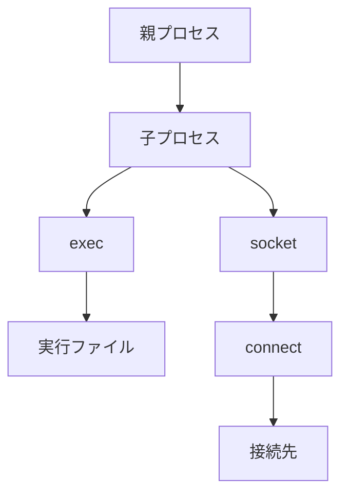
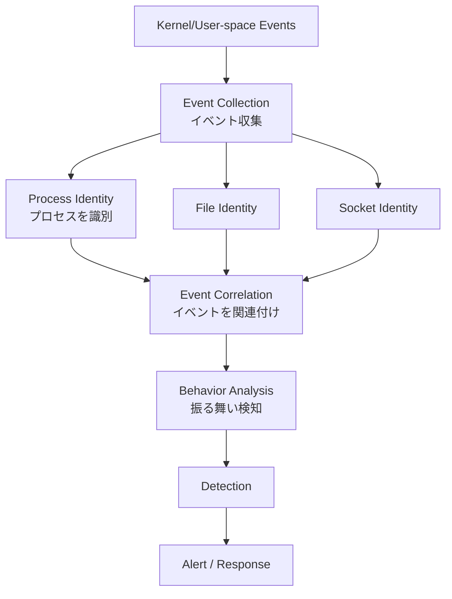

eBPF（extended Berkeley Packet Filter）とは、Linuxカーネル内で安全に小さなプログラムを実行し、システムの挙動を観測・制御するための仕組み

触ってみたくなり、Colima上のLinux VMでbpftraceを動かしてみた

今回はシステムコールを観測しながら、Linuxカーネルのイベントをどこまで取得できるのかを確認する

最終的には、取得したイベントを組み合わせてEDRがどのようにプロセスの振る舞いを分析しているのかまで考えてみる

## bpftraceで見るシステムコール

### 準備

macOS上ではLinuxカーネルのeBPF機能を直接利用できないため、ColimaのLinux VMを実験環境にする

Colimaに接続してbpftraceをインストール

```bash
colima ssh
```

```bash
sudo apt-get install -y bpftrace
```

インストール後、カーネル情報とbpftraceの対応状況を確認

```bash
sudo bpftrace --info
```

`--info` では利用可能なカーネルヘルパーやProbe Typeなどを確認できる

今回の環境では `kprobe` と `tracepoint` の両方が利用可能だった

### Tracepointを探す

まずはシステムコールを拾えるかの確認

```bash
$ sudo bpftrace -l 'tracepoint:syscalls:sys_enter_execve'
tracepoint:syscalls:sys_enter_execve
```

これは`execve` システムコールの入口イベントの観測点があるか確認するもの

観測点はTracepointと呼ばれ、カーネル内に定義されている
これはシステムコールだけでなくカーネル内のさまざまな処理(イベント)の観測を提供する

イベント発生時にはここにアタッチしたeBPFプログラムが実行される

`sys_enter_execve` はexecveシステムコールの入口で発生するTracepoint

`execve`には引数がわたるが、それもTracepointで観測できる
詳細は以下で確認できる

```bash
$ sudo bpftrace -lv 'tracepoint:syscalls:sys_enter_execve'
tracepoint:syscalls:sys_enter_execve
    int __syscall_nr
    const char * filename
    const char *const * argv
    const char *const * envp
```

そのイベントで参照できるフィールドをC言語風の型で表している

このフィールドを取り出すにはTracepointの構文で `->` を使う
引数は `args` にまとまっているので、取り出す際にbpftraceではこの用に記述(後ほど使う)

```
args->__syscall_nr
args->filename
args->argv
args->envp
```

## 実行の観測

まずはexecveの呼び出しを観測してみる

bpftraceで観測を立ち上げる

```bash
sudo bpftrace -e '
tracepoint:syscalls:sys_enter_execve
{
  printf("PID=%d COMM=%s FILE=%s\n", pid, comm, str(args->filename));
}'
```

`args->filename` と書くことで、`execve` 呼び出し時に渡された実行ファイルのパスを取り出す

別のターミナルからコマンドを実行する

```bash
colima ssh -- sh -c 'ls /; whoami; date'
```

bpftrace側の出力

```txt
PID=1560925 COMM=sshd FILE=/bin/bash
PID=1560925 COMM=bash FILE=/bin/bash
PID=1560926 COMM=bash FILE=/usr/bin/locale-check
PID=1560927 COMM=bash FILE=/usr/bin/locale
PID=1560925 COMM=bash FILE=/usr/bin/whoami
```

ちなみに`sys_enter_execve` はカーネル処理に入った直後であり、プログラムの実行完了前である

`execve` がまだ処理を完了していない時点で観測しているため、COMM には呼び出し元プロセスの名前が残っている

実行後のイベント`sched_process_exec` を観測する

```bash
$ sudo bpftrace -lv 'tracepoint:sched:sched_process_exec'
tracepoint:sched:sched_process_exec

    __data_loc char[] filename
    pid_t pid
    pid_t old_pid
```

```bash
$ sudo bpftrace -e '
tracepoint:sched:sched_process_exec {
  printf("PID=%d OLD_PID=%d FILE=%s\n",
    args->pid,
    args->old_pid,
    str(args->filename)
  );
}'

# [別ターミナル] 
# colima ssh -- sh -c 'ls /; whoami; date'

PID=1719012 OLD_PID=1719012 FILE=/usr/bin/ls
PID=1719013 OLD_PID=1719013 FILE=/usr/bin/whoami
PID=1719014 OLD_PID=1719014 FILE=/usr/bin/date
```

同じexecでも、観測するタイミングによって取得できる情報が変わる

## 通信の観測

次はネットワーク関連のシステムコールを観測する

今回は `socket` と `connect` を対象にする

```bash
$ sudo bpftrace -e '
tracepoint:syscalls:sys_enter_socket,
tracepoint:syscalls:sys_enter_connect
/comm != "python" && comm != "nginx" && comm != "uvicorn"/
{
  printf("PID=%d COMM=%s\n", pid, comm);
}'

# [別ターミナル] 
# colima ssh -- curl example.com  

PID=1729289 COMM=curl
PID=1729289 COMM=curl
PID=1729289 COMM=curl
PID=1729289 COMM=curl
PID=1729289 COMM=curl
PID=1729289 COMM=curl
PID=1729289 COMM=curl
PID=1729289 COMM=curl
PID=1729289 COMM=curl
PID=1729289 COMM=curl
PID=1729289 COMM=curl
PID=476 COMM=dnsmasq
PID=476 COMM=dnsmasq
PID=1729289 COMM=curl
PID=1729289 COMM=curl
PID=1729289 COMM=curl
PID=1729289 COMM=curl
PID=1729289 COMM=curl
PID=1729289 COMM=curl
PID=1729289 COMM=curl
```

プロセスがソケットを生成したり、接続要求を発行したりするタイミングを観測

### connectの引数

connectのシステムコール定義は次のとおり

```c
int connect(
    int sockfd,
    const struct sockaddr *addr,
    socklen_t addrlen
);
```

`addr` は接続先のIPアドレスやポートなどを持つ `sockaddr` へのポインタ

システムコールの引数として渡されるが、ポインタが指しているメモリは**ユーザー空間**にある

eBPFから接続先情報を取得する場合も、ユーザー空間のポインタを読み取る必要がある

## プロセスの特定



プロセスは複数のシステムコールを呼ぶ
eBPF観測からプロセスを特定する際にはこの図を下からたどるアプローチをする

例えばPIDだけでイベントを紐付けるとしても

プロセスが終了すると、そのPIDは別のプロセスへ再割り当てされる可能性がある

そのため、PIDだけをキーにイベントを保存し続けると、異なるプロセスのイベントを誤って関連付けてしまう

実際には次のような情報も考慮する必要がある

- PIDとプロセス開始時刻
- PPIDとプロセスツリー
- execイベントによる実行イメージの変化
- exitイベントによるプロセスの終了
- PID namespace

Tracepointでは次のようなイベントが使える

| イベント | 取れる情報 |
| --- | --- |
| sched_process_fork | 子PIDD、親PID |
| sched_process_exec | 実行ファイル、新旧PID |
| sched_process_exit | 終了したPID |

個々のイベントを取得するだけでは、システム全体の振る舞いは復元できないため

イベントの発生順序、プロセスのライフサイクル、ソケットとの関係などを関連付ける

プロセスの特定はかなり難しいのではと思える

## EDRのやっていること

ここまでの内容をあくまで一部だがEDRの仕組みに当てはめてみる

EDRでは、カーネルやユーザー空間からさまざまなイベントを取得し、それらを組み合わせてプロセスの振る舞いを分析する



今回はプロセス実行と通信だけを見たが、実際の EDR はファイル・メモリ・認証なども扱う。取得手段はeBPFに限らない

## まとめ

- Tracepoint：カーネル内にあらかじめ用意された観測点
- eBPF：その観測点で動かす、検証済みの小さなプログラム
- bpftrace：TracepointなどへeBPFプログラムを簡単に登録・実行するツール


